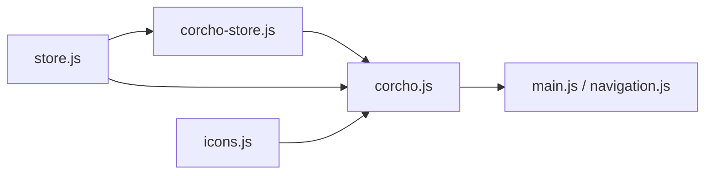

# Plan de Implementación v2.0 — Módulo Independiente **Corcho**

> **Estado:** v2.0 (ajustado tras `/egm-review`; listo para ejecución).  
> **Rama sugerida:** `feat/corcho-module` (desde `main`).  
> **Referencias:** [`DEFINICION_CORCHO.md`](./DEFINICION_CORCHO.md) · [`../.agents/skills/trafigator-ui/SKILL.md`](../.agents/skills/trafigator-ui/SKILL.md)  
> **Regla rectora:** **Un clic o menos.** 100% frontend (`localStorage` + IndexedDB), 100% desacoplado de `src/sketch/desktop*.js` y sin importar nada de `Plugins/Tablero de Corcho/`.

---

## 1. Decisiones de Arquitectura y Contratos Técnicos

### 1.1. Barra superior derecha de `#pane-center` (`sketch-ot.html:308-342`)
- Se mantienen intactos los 5 botones existentes (`Compartir`, `Colapsar / Expandir`, `Nuevo`, `Deshacer`, `Rehacer`) y `#btn-right-expand`, sin duplicar ninguno.
- Se añade **únicamente 1 botón nuevo**:
  - `#btn-global-corcho` (`data-icon="pin"`, `data-tip="Corcho"`, `aria-expanded="false"`).
- **No** se añade `+ Nueva OT` ni un botón duplicado de `Modo Foco` (si en el futuro se desea `Modo Foco`, se cableará sobre el botón `Colapsar / Expandir` existente reutilizando `collapse-diagonal`/`expand-diagonal`).
- **Íconos Lucide a registrar en `src/client/icons.js` (5):** `pin`, `send`, `folder-input`, `sticky-note`, `globe` *(ya existen `plus`, `trash-2`, `x`, `archive`, `rotate-ccw`, `maximize-2`, `download`, `eye`, `share-2`, `copy`, `file`)*.

### 1.2. Montaje de `#corcho-overlay`, `z-index` y preservación de scroll
- En `sketch-ot.html:346`, `#center-body` tiene `overflow-y-auto` sin `relative`. Para preservar su `scrollTop` exacto sin desplazar el overlay:
  - Envolver `#center-body` en un contenedor padre **no scrolleable**: `<div id="center-stage" class="relative flex-1 min-h-0 flex flex-col">`.
  - Montar `#corcho-overlay` como **hermano** de `#center-body` dentro de `#center-stage`:
    ```html
    <div id="corcho-overlay" class="hidden absolute inset-0 z-[45] bg-[#191919] flex flex-col min-h-0 overflow-hidden"></div>
    ```
  - `z-[45]` supera los dropdowns internos (`z-30` en `#view-new-ot`) sin tapar `#resizer-*`, `#user-menu-popover`, `#notifications-popover` ni `#new-client-modal` (`fixed z-50`). Al abrir Corcho se cierran los dropdowns/popovers internos de `#center-body` (ej. filtro de galería `z-50`).
- `#pane-left` y `#pane-right` permanecen visibles; `#center-body` conserva intactos su DOM y su `scrollTop`.

### 1.3. Aislamiento de eventos globales y cierre en navegación
- **Guardas `isCorchoOpen()`** (evitan mutaciones en segundo plano mientras Corcho cubre `#center-body`):
  - `src/sketch/desktop.js`: ignorar `Escape` y `document.click` (`closeQ4Context`) si `isCorchoOpen()`.
  - `src/sketch/gallery.js`: incluir `'corcho-overlay'` en `isAnyOverlayOpen()` (bloquea `Escape` y flechas `Arrow*` sobre la galería subyacente).
  - `src/sketch/settings.js`: ignorar `Escape` sobre `#settings-modal` si `isCorchoOpen()`.
  - `src/sketch/main.js`: ignorar `⌘Z`/`⌘Y` (`undoOrders`/`redoOrders`) si `isCorchoOpen()`.
- **Listener de `Escape` controlado:** adjunto a `document` al abrir Corcho y removido al cerrar (cero leaks). Si hay un popover/modal superior abierto (`#user-menu-popover`, `#notifications-popover`, `#new-client-modal`, `#user-modal-host`), `Escape` no cierra Corcho. Dentro de Corcho: **1.er `Esc`** cierra vista previa/panel inline de ficha; **2.º `Esc`** cierra Corcho.
- **Cierre automático al navegar:** cerrar `#corcho-overlay` al disparar cualquier navegación desde `#pane-left` (`.ot-sub-btn`, `#btn-desktop-menu`, `#btn-left-back`), `#btn-center-back-traffic`, `#settings-modal` (`#btn-settings-menu`, `#btn-studio-footer`, `#btn-trial-badge`), y los canales `open-ot` y `open-review` en `main.js`.

### 1.4. Arquitectura modular (2 archivos iniciales, DAG lineal)



- **`src/sketch/corcho-store.js`**: esquema de ficha, persistencia `localStorage` plana (`active | archived`, sin RBAC ni partición `Global | Personal` en fase local), helper mínimo IndexedDB (`putBlob`, `getBlob`, `deleteBlob`), validadores `normalizeSafeWebUrl` e `isSafeMediaSrc`, y contador de referencias de blobs promovidos a OTs.
- **`src/sketch/corcho.js`**: ciclo de vida (`initCorcho`, `openCorcho`, `closeCorcho`, `toggleCorcho`, `isCorchoOpen`), render de captura/cuadrícula/preview/acciones, delegación de eventos confinada a `#corcho-overlay`, registro centralizado de `URL.createObjectURL` revocado en cada cambio de ficha/re-render/cierre, e hidratación `hydrateIcons(overlay)`.
- *Regla de extracción:* extraer `src/sketch/corcho-preview.js` únicamente si `corcho.js` supera ~450 líneas.

### 1.5. Esquema de datos, cuota y seguridad (fase local)
- **Clave `localStorage`:** `trafigator_corcho_items_v1` (array JSON plano; recuperación segura ante JSON corrupto).
- **IndexedDB:** base `trafigator_corcho_blobs_v1`, objectStore `blobs` (`keyPath: 'id'`).
  - Límite explícito por archivo: **15 MB** (`MAX_CORCHO_FILE_BYTES = 15 * 1024 * 1024`).
  - Manejo de `QuotaExceededError` / fallo IDB con aviso limpio en UI (nunca persistir la ficha en `localStorage` si falló `putBlob`).
  - Fallback visual si una ficha referencia un `blobId` ausente en IndexedDB (sin errores en consola).
  - **Protección contra blobs huérfanos en `Mover a OT`:** cada ficha conserva `promotedOtIds: string[]`; al eliminar una ficha del Corcho, su blob en IndexedDB solo se purga si `promotedOtIds.length === 0`.
- **Esquema de ficha:**
  ```js
  {
    id: 'cr-<timestamp>-<rand>',
    type: 'note' | 'link' | 'file',
    title: 'string',        // derivado de 1.ª línea (máx. 80 chars), dominio o file.name
    content: 'string',      // cuerpo de nota o extracto opcional
    url: 'string | null',   // solo http:/https: validado por normalizeSafeWebUrl
    fileMeta: { name, mime, size, sizeLabel, blobId } | null,
    privateNotes: [{ id, text, at }],
    status: 'active' | 'archived',
    promotedOtIds: [],
    createdAt: 'ISO',
    archivedAt: 'ISO | null',
    updatedAt: 'ISO',
  }
  ```
- **Reglas de detección de entrada ("Poner"):**
  - `https://...` o `http://...` (una sola URL sin espacios) → `link` (bloquea `javascript:`, `data:`, `vbscript:`).
  - Archivo seleccionado o soltado → `file` (bloquea `.svg`, `.html`, `.htm`, `.xhtml`, `.js` como vista previa embebida segura; si es inseguro, se rechaza o guarda solo como descarga segura sin renderizar).
  - Cualquier otro texto → `note`.
- **Visor de archivos en vista previa:**
  - `` inline para imágenes seguras (`png/jpg/gif/webp/avif`).
  - `<video controls>` inline para video seguro (`mp4/mov/webm`).
  - **PDF y otros documentos:** tarjeta limpia de metadatos + botones de 1 clic **`Abrir`** (`window.open` de blob URL) y **`Descargar`** (sin `<iframe src="blob:...">`).

### 1.6. Contratos de `Compartir` (HU-01) y `Mover a OT / Tarea` (HU-02)
- **Compartir sin OT (HU-01, 1 clic):**
  - Propósito por defecto: **`Para dar a conocer`** (con toggle opcional de 1 clic a **`Para revisar`**).
  - **Por Mensaje:** clic directo en un integrante de `studioTeamList` → copia al portapapeles el texto formateado (`Para <persona> (<propósito>): <título/contenido/url>`) con confirmación visual `"Copiado para enviar a <persona>"` (fallback `textarea` si falta `navigator.clipboard`). Si es ficha `file`, muestra aviso explícito de exportar/adjuntar el archivo manualmente.
  - **Por Correo:** clic en `Correo` (integrante o email libre) → abre `mailto:<email>?subject=...&body=...` prellenado con título, contenido/URL y propósito (más aviso de adjunto manual si es `file`).
- **Mover a OT / Tarea / Nueva OT (HU-02, 1 clic):**
  - Acciones directas sin checkbox extra de auto-archivo (auto-archiva automáticamente tras mover exitosamente, siempre recuperable desde `Historial`).
  - **A OT existente:** llama `ensureOtData(ot)`; si es `note`/`link` agrega mensaje vía `appendOtMessage(ot, { text, channel: 'App', actor: userProfile.shortName })`; si es `file` agrega ítem a `ot.mediaFiles` (`{ name, meta: sizeLabel, status: 'En Revisión', taskTitle: 'OT', dateOrder: Date.now(), corchoBlobId: blobId }` — **nunca `dataUrl`** para no inflar el stack undo/redo de `trafficOrders`) y registra `ot.id` en `promotedOtIds`. Emite `notifySketchChange('orders')`.
  - **A Tarea (`subtasks`):** llama `ensureOtData(ot)`, agrega sub-tarea con campos completos (`{ title, responsible: userProfile.shortName || 'Equipo', department: ot.department || 'Tráfico', status: 'Pendiente', entryDate: todayIso, deliveryDate: ot.deliveryDate || todayIso, scheduledDate: null, estimatedHours: 1, notes: content || url || fileMeta?.name || '', routes: [], mediaFiles: [] }`), y emite `notifySketchChange('orders')` + `notifySketchChange('stripboard')`.
  - **A Nueva OT:** exportar `prefillNewOt({ title, notes, onCreated })` desde `src/sketch/new-ot.js`; abre `#view-new-ot` prellenando `#ot-header-title` y `#ot-desc-input`, y ejecuta el auto-archivo de la ficha **únicamente dentro del callback `onCreated`** tras un `submit` exitoso (si el usuario cancela, la ficha sigue activa en el Corcho).

---

## 2. Plan en 3 Pasos Verticales

> **Criterio obligatorio en TODOS los pasos (sin fase de higiene tardía):**
> - Estética Obsidian plana (sin sombras), todos los `<input>`/`<textarea>` con `id`, `name` y `<label for>` o `aria-label`.
> - Revocación centralizada de `URL.createObjectURL` en cada transición/re-render/cierre.
> - Validación verde antes de commitear: `node --check` en todos los `.js` tocados, `npx tsc --noEmit` (0 errores) y `npx vite build` (0 errores, 0 warnings).

---

### Paso 1 — Acceso global, overlay aislado, `corcho-store.js` y Acción 1 (`Poner`)
- **Qué entra:**
  - Actualizar [`docs/DEFINICION_CORCHO.md`](./DEFINICION_CORCHO.md) documentando el acceso mediante el botón `Corcho` en la esquina superior derecha de `#pane-center` y su comportamiento de capa ampliada.
  - Registrar en `src/client/icons.js` los 5 íconos faltantes (`pin`, `send`, `folder-input`, `sticky-note`, `globe`).
  - Añadir `#btn-global-corcho` en `sketch-ot.html` (sin tocar los 5 botones existentes) y envolver `#center-body` en `#center-stage` (`relative flex-1 min-h-0 flex flex-col`) con `#corcho-overlay` como hermano (`z-[45]`).
  - Implementar guardas `isCorchoOpen()` en `desktop.js`, `gallery.js` (`isAnyOverlayOpen()`), `settings.js` y `main.js` (`⌘Z`/`⌘Y`), listener controlado de `Escape`, y cierre automático en todos los disparadores de navegación (`navigation.js`, `main.js`, `settings.js`).
  - Crear `src/sketch/corcho-store.js` (lista plana `localStorage`, IndexedDB `putBlob`/`getBlob`/`deleteBlob` con límite 15 MB y manejo de cuota, `normalizeSafeWebUrl`, `isSafeMediaSrc`).
  - Crear `src/sketch/corcho.js`: cabecera del Corcho, barra de captura instantánea (**Poner** en ≤1 clic/Enter/drag & drop: nota, enlace o archivo) y cuadrícula activa Obsidian.
- **Qué NO entra:** vista previa/apuntes privados, Archivar/Historial, Exportar, Eliminar, Compartir ni Mover a OT.
- **Archivos:**
  - Modificar: `docs/DEFINICION_CORCHO.md`, `src/client/icons.js`, `sketch-ot.html`, `src/sketch/navigation.js`, `src/sketch/main.js`, `src/sketch/desktop.js`, `src/sketch/gallery.js`, `src/sketch/settings.js`
  - Crear: `src/sketch/corcho-store.js`, `src/sketch/corcho.js`
- **Checklist `/browser`:**
  - [ ] Los 5 botones previos de la barra superior siguen intactos; `#btn-global-corcho` muestra ícono `pin` sin colisionar con `#workspace-bar`.
  - [ ] Hacer scroll en una OT/Tráfico → abrir Corcho → overlay fijo en todo `#pane-center`, `#pane-left` y `#pane-right` visibles → cerrar con `Corcho`, `×` o `Esc` → scroll y contexto de la OT intactos.
  - [ ] Pulsar `Esc`, flechas y `⌘Z` dentro de Corcho no altera `Tablero`, `Galería`, `Ajustes` ni `trafficOrders` debajo.
  - [ ] Poner nota (*"Comprar café"*), enlace (`https://...`) y archivo (PNG/PDF) en ≤1 clic/Enter; recargar y confirmar persistencia; `javascript:alert(1)` y `.svg`/`.html` quedan bloqueados.

---

### Paso 2 — Acciones 2, 5, 6 y 7 (`Consultar / Anotar en privado`, `Archivar / Historial`, `Exportar`, `Eliminar`)
- **Qué entra:**
  - **Consultar / Anotar en privado:** al abrir una ficha, vista de lectura/edición inline (nota editable con autoguardado, enlace con `Abrir ↗`, `` / `<video controls>` o tarjeta PDF/archivo con `Abrir` vía `window.open` + `Descargar`) y panel de **apuntes privados** (abierto por defecto en archivos/enlaces, colapsable en notas breves para respetar *"Un clic o menos"*).
  - Prioridad de `Esc`: 1.er `Esc` cierra vista previa de ficha; 2.º `Esc` cierra Corcho.
  - **Archivar con Historial:** botón `archive` en 1 clic mueve a `status: 'archived'`; conmutador `Activos | Historial`, buscador rápido en Historial y botón `Restaurar` (`rotate-ccw`) en 1 clic.
  - **Exportar:** botón `download` en 1 clic descarga el binario original desde IndexedDB o exporta nota/enlace como `.md`.
  - **Eliminar:** botón `trash-2` en 1 clic elimina definitivamente (purgando blob en IndexedDB si `promotedOtIds.length === 0`).
  - *(Extraer `src/sketch/corcho-preview.js` solo si `corcho.js` supera ~450 líneas).*
- **Qué NO entra:** Compartir ni Mover a OT/Tarea.
- **Archivos:**
  - Modificar: `src/sketch/corcho-store.js`, `src/sketch/corcho.js` *(+ `src/sketch/corcho-preview.js` solo si supera ~450 líneas)*
- **Checklist `/browser`:**
  - [ ] Abrir ficha de archivo/PDF → agregar apunte privado → 1.er `Esc` vuelve a cuadrícula, 2.º `Esc` cierra Corcho → reabrir y confirmar persistencia del apunte.
  - [ ] En nota breve (*"Comprar café"*), el panel de apuntes arranca colapsado y puede abrirse en 1 clic.
  - [ ] Archivar ficha → desaparece de `Activos` → aparece en `Historial` → buscar y restaurar en 1 clic.
  - [ ] Exportar nota (`.md`) y archivo (binario original); eliminar ficha efímera en 1 clic y confirmar desaparición total y sin errores en consola.

---

### Paso 3 — Acciones 3 y 4 (`Compartir` y `Mover a OT / Tarea / Nueva OT`) + `SKILL.md`
- **Qué entra:**
  - **Compartir (HU-01):** popover/panel inline con propósito por defecto `Para dar a conocer` (toggle `Para revisar`), clic directo en integrante de `studioTeamList` (copia mensaje formateado al portapapeles con confirmación `"Copiado para enviar a <persona>"`) o correo (`mailto:` prellenado para integrante o email libre, con aviso de adjunto manual si es `file`).
  - **Mover a OT / Tarea / Nueva OT (HU-02):** selector inline de OT + botones directos `A OT`, `A Tarea` y `Nueva OT` (auto-archivo automático tras éxito):
    - `A OT`: `ensureOtData(ot)` → `appendOtMessage` (nota/enlace) o `ot.mediaFiles` con referencia `corchoBlobId` sin `dataUrl` (archivo) + `notifySketchChange('orders')`.
    - `A Tarea`: `ensureOtData(ot)` → inserta sub-tarea completa en `ot.subtasks` + `notifySketchChange('orders')` y `notifySketchChange('stripboard')`.
    - `Nueva OT`: añadir `prefillNewOt({ title, notes, onCreated })` en `src/sketch/new-ot.js`; auto-archivar la ficha solo en `onCreated` (si el usuario cancela, permanece activa).
  - Actualizar [`.agents/skills/trafigator-ui/SKILL.md`](../.agents/skills/trafigator-ui/SKILL.md) documentando `#btn-global-corcho`, `#corcho-overlay` y `src/sketch/corcho*.js`.
- **Qué NO entra:** backend ni tablas SQLite.
- **Archivos:**
  - Modificar: `src/sketch/corcho-store.js`, `src/sketch/corcho.js`, `src/sketch/new-ot.js`, `src/sketch/main.js`, `.agents/skills/trafigator-ui/SKILL.md`
- **Checklist `/browser`:**
  - [ ] **HU-01:** poner `"Correo Impresor — impresor@imprenta.com"` → `Compartir` con clic directo en integrante (confirma copiado) y opción correo (`mailto:`) → `Archivar` → localizar en `Historial`.
  - [ ] **HU-02:** subir insumo → `A OT` / `A Tarea` → abrir la OT y Stripboard confirmando que aparece allí y que la ficha se archivó en Corcho; probar `Nueva OT` cancelando (la ficha sigue activa) y creando (la ficha se archiva).
  - [ ] **HU-03 y HU-04:** recorrido completo de las 4 historias con consola del navegador limpia (0 errores).
